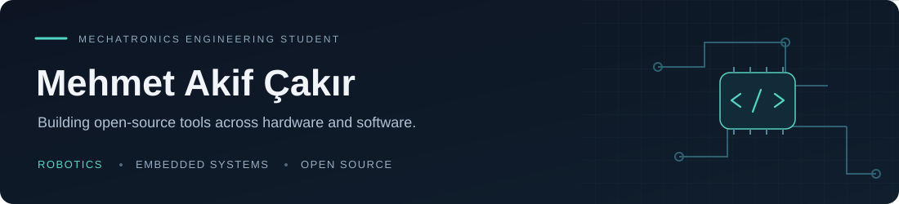
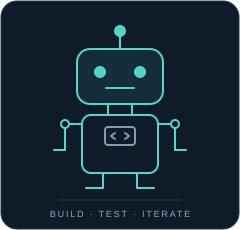
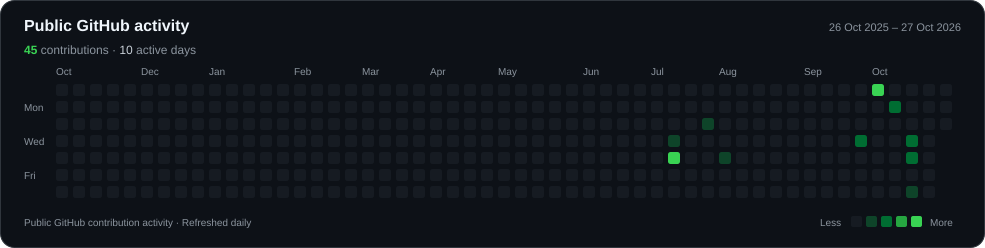

  

  <a href="https://mehmetakifcakr.github.io/mehmetakifcakir.github.io/">Portfolio</a> &nbsp;·&nbsp;
  <a href="https://www.linkedin.com/in/ma-cakr/">LinkedIn</a> &nbsp;·&nbsp;
  <a href="mailto:mehmetakifcakrr@gmail.com">Email</a> &nbsp;·&nbsp;
  <a href="https://orcid.org/0009-0008-9355-7559">ORCID</a>

## About

I'm a **mechatronics engineering student at Manisa Celal Bayar University**, based in **Izmir, Türkiye**. I build and document open-source projects at the intersection of robotics, embedded systems and software.

My current work explores reliable decision engines, small robotics abstractions and reproducible simulation tools. I value clear interfaces, useful examples and honest documentation of what a project can do today.

## Selected projects

| Project | What I'm building | Stack & stage |
|:--|:--|:--|
| **[RecoverTick](https://github.com/mehmetakifcakr/recovertick)** | A zero-dependency decision engine for embedded controllers, with bounded recovery and verified replay. | **Rust · `no_std`** 0.1.0 MVP |
| **[OpenRobotKit](https://github.com/mehmetakifcakr/OpenRobotKit)** | A robotics toolkit starting with a Python motor abstraction, with Arduino and ESP32 support on the roadmap. | **Python · Robotics** Early development |
| **[AI Trader Paper](https://github.com/mehmetakifcakr/ai-trader-paper)** | An offline-first research simulator with a shared paper portfolio and explicit execution limits. | **Python · Machine learning** Alpha · local simulation only |

## Engineering focus

- **Languages:** Python, C++ and Rust.
- **Hardware & control:** Arduino, ESP32, motor control and sensor integration.
- **Software:** automation, simulation, testing and reproducible examples.
- **Design:** 3D CAD and prototyping.

I'm developing these interests through small, inspectable projects. Next up: stronger examples and tests, durable simulation state and clearer hardware interfaces.

 

## Open-source activity

Generated from GitHub's public contribution calendar and refreshed daily. Private activity is not included.

## Connect

For project discussions, examples or bug reports, open an issue in the relevant repository. For professional conversations, reach me on [LinkedIn](https://www.linkedin.com/in/ma-cakr/) or at **[mehmetakifcakrr@gmail.com](mailto:mehmetakifcakrr@gmail.com)**.
